# Distributed Job Engine

A PostgreSQL-backed distributed job execution engine built in Python,
designed to execute jobs across multiple workers while handling worker
failures, concurrent execution, bounded retries, lease expiration,
and duplicate side effects.

The project explores the fundamental challenges of building reliable
distributed systems using PostgreSQL as both a persistence layer
and a coordination mechanism.

Rather than relying on existing task queue frameworks such as Celery
or RabbitMQ, the core execution and coordination mechanisms are
implemented from scratch.

## Project Objectives

- Build a distributed job execution engine from first principles.
- Coordinate multiple workers without an external distributed lock manager.
- Prevent conflicting job claims through database-level concurrency control.
- Recover jobs when workers crash or lose ownership.
- Protect job state from stale workers using fencing tokens.
- Support bounded retries and terminal failure states.
- Understand and handle the consequences of at-least-once execution.
- Validate correctness through unit, integration, and fault-injection tests.

## Current Status

The core execution and coordination mechanisms have been implemented
and tested.

| Component                            | Status                          |
| ------------------------------------ | ------------------------------- |
| PostgreSQL persistence               | Implemented                     |
| Job state machine                    | Implemented                     |
| Atomic job claiming                  | Implemented                     |
| Concurrent worker coordination       | Implemented                     |
| Lease management                     | Implemented                     |
| Worker heartbeats                    | Implemented                     |
| Bounded retries                      | Implemented                     |
| Expired job recovery                 | Implemented                     |
| Fencing tokens                       | Implemented                     |
| Job submission uniqueness constraint | Implemented                     |
| Idempotent handler behavior          | Validated through tests         |
| Fault-injection testing              | Completed for current scenarios |
| Worker runtime and orchestration     | Next milestone                  |
| Job submission API                   | Planned                         |
| Observability and monitoring         | Planned                         |
| Performance benchmarking             | Planned                         |
| Containerization and deployment      | Planned                         |

## Architecture

PostgreSQL acts as the durable source of truth for job state and
worker ownership.

Workers coordinate through database transactions, row-level locks,
leases, and fencing tokens rather than communicating directly
with one another.

The following diagram represents the logical architecture of the
implemented execution primitives. Continuous worker orchestration
is the next development milestone.

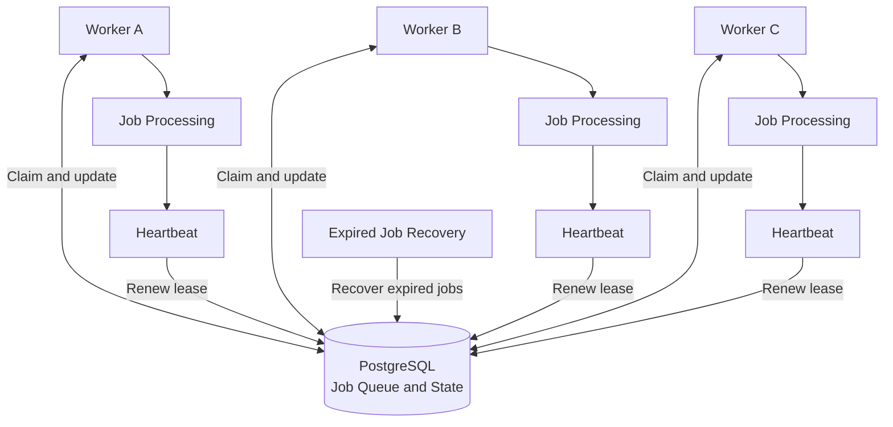

### Architectural Components

| Component        | Responsibility                                           |
| ---------------- | -------------------------------------------------------- |
| Persistence      | Database connections and job schema                      |
| Job claiming     | Atomically assigns available jobs to workers             |
| Job execution    | Executes the job handler                                 |
| Job processing   | Coordinates execution, heartbeats, and state transitions |
| Heartbeat        | Periodically renews worker leases                        |
| Completion       | Marks successfully executed jobs as completed            |
| Failure handling | Requeues or permanently fails unsuccessful jobs          |
| Recovery         | Recovers jobs whose worker leases have expired           |
| Fencing          | Rejects state updates from stale execution attempts      |

## Job Data Model

Each job is represented by a durable record in PostgreSQL.

| Field              | Description                                    |
| ------------------ | ---------------------------------------------- |
| `id`               | Unique job identifier                          |
| `idempotency_key`  | Unique identifier for a logical job submission |
| `payload`          | JSONB data required to execute the job         |
| `status`           | Current job lifecycle state                    |
| `worker_id`        | Identifier of the assigned worker              |
| `attempt`          | Number of times the job has been claimed       |
| `max_attempts`     | Maximum permitted execution attempts           |
| `lease_expires_at` | Expiration time of the current ownership lease |
| `created_at`       | Job creation timestamp                         |

The `attempt` field serves two purposes:

1. Tracks the number of execution attempts.
2. Acts as a monotonically increasing fencing token for each job.

The `idempotency_key` has a database-level uniqueness constraint
to prevent duplicate logical job records.

See [Database Schema](engine/persistence/schema.sql).

## Job Lifecycle

A job transitions through four states:

- `PENDING`: Available for execution.
- `RUNNING`: Claimed by a worker.
- `COMPLETED`: Successfully executed.
- `FAILED`: Permanently failed after exhausting its attempts.

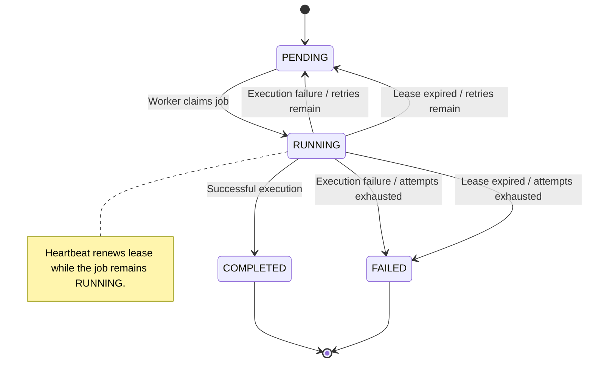

A job is not eligible for another claim while it remains in the
`RUNNING` state.

An expired running job must first be recovered before another
worker can claim it.

See [Job Lifecycle](docs/02-job-lifecycle.md).

## Core Execution Mechanisms

### 1. Atomic Job Claiming

Multiple workers may attempt to claim jobs simultaneously.

Without concurrency control, two workers could read the same
pending job and both believe they own it.

The engine uses PostgreSQL row-level locking:

```sql
SELECT ...
FROM jobs
WHERE status = 'PENDING'
  AND attempt < max_attempts
ORDER BY created_at
FOR UPDATE SKIP LOCKED
LIMIT 1;
```

The selection and ownership update occur within the same transaction.

When a job is claimed:

- Its status becomes `RUNNING`.
- The worker identifier is assigned.
- The attempt counter is incremented.
- A lease expiration timestamp is established.

The transaction must commit before job execution begins.

`SKIP LOCKED` allows competing workers to skip rows currently
locked by another transaction and claim other available jobs
instead of waiting for those locks to be released.

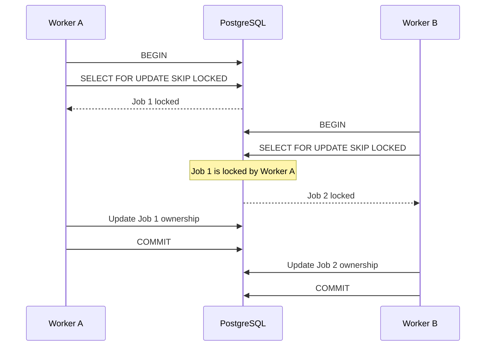

This provides exclusive claiming while allowing workers to
make concurrent progress.

Jobs are selected in creation-time order among eligible,
unlocked rows. This is not a strict global FIFO guarantee
under concurrent execution.

Implementation:

- [claim_job.py](engine/workers/claim_job.py)

Documentation:

- [Concurrency and Locking](docs/03-concurrency-and-locking.md)

### 2. Lease-Based Ownership

A database row lock protects the job-claiming transaction,
but it does not protect the entire execution lifecycle.

Holding a database transaction open throughout job execution
would introduce unnecessary contention and long-lived locks.

Instead, the engine uses time-limited ownership leases.

Current configuration:

| Parameter              | Value      |
| ---------------------- | ---------- |
| Default lease duration | 30 seconds |
| Heartbeat interval     | 10 seconds |

After claiming a job, a worker owns it for the duration of
its lease.

A background heartbeat periodically renews the lease while
the job is executing.

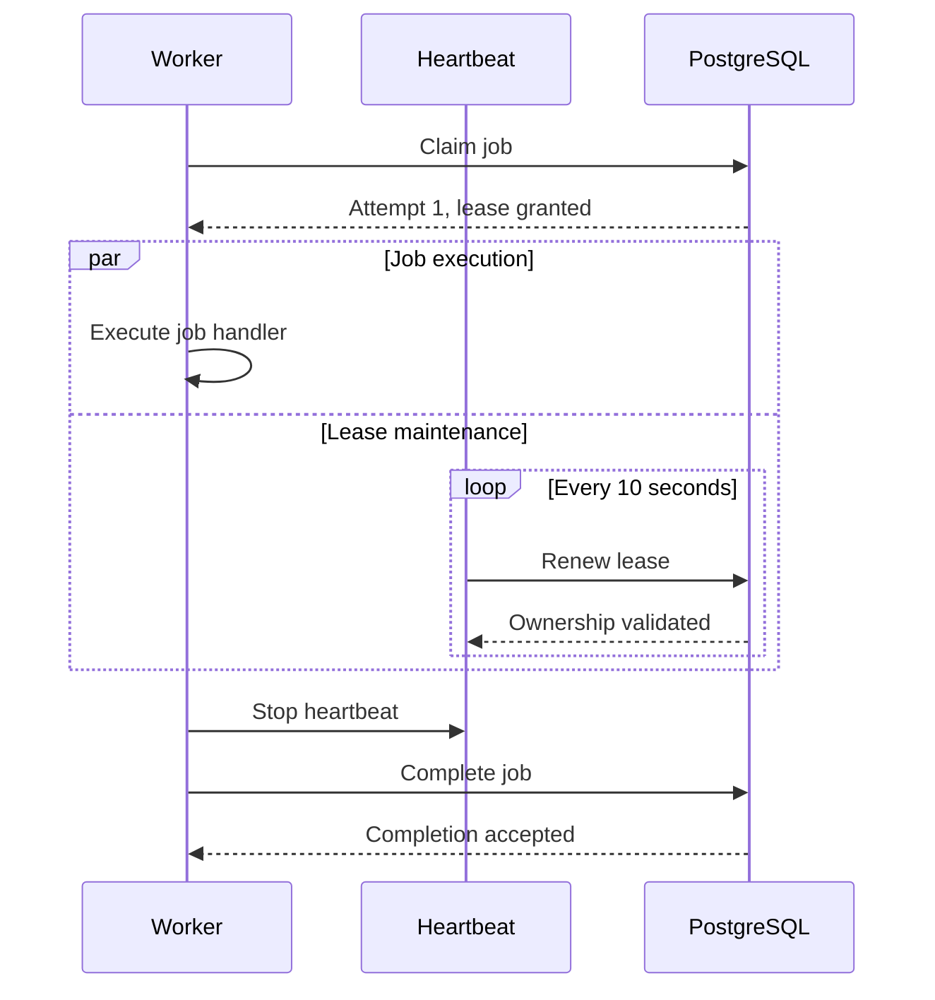

Lease renewal requires:

- The job to be in the `RUNNING` state.
- The worker identifier to match.
- The execution attempt to match.
- The existing lease to remain valid.

If ownership is lost, the worker must not update the job
as completed or failed.

Ownership loss does not necessarily interrupt a handler
that is already executing.

Implementation:

- [renew_lease.py](engine/workers/renew_lease.py)
- [heartbeat_loop.py](engine/workers/heartbeat_loop.py)
- [process_job.py](engine/workers/process_job.py)

Documentation:

- [Leases and Heartbeats](docs/04-leases-and-heartbeats.md)

### 3. Worker Failure and Job Recovery

Workers can crash, disconnect, or stop renewing their leases.

Without a recovery mechanism, jobs assigned to failed workers
could remain in the `RUNNING` state indefinitely.

The recovery mechanism identifies running jobs whose leases
have expired and transitions them according to their remaining
attempt budget.

| Condition                            | Result    |
| ------------------------------------ | --------- |
| Lease expired and attempts remain    | `PENDING` |
| Lease expired and attempts exhausted | `FAILED`  |
| Lease remains valid                  | Unchanged |
| Job already completed                | Unchanged |

Recovery clears the previous ownership information while
preserving the attempt counter.

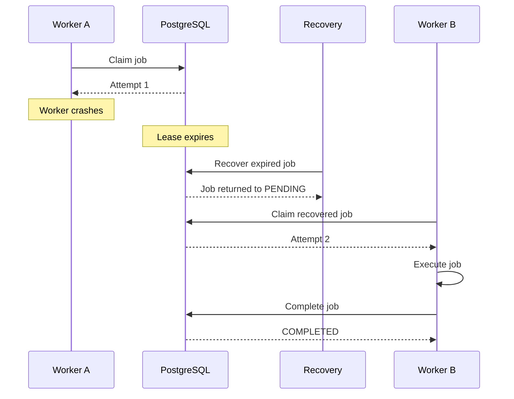

Recovery is idempotent.

Repeated recovery operations do not repeatedly transition
the same expired execution.

Concurrent recovery operations are also tested to ensure
that an expired job is recovered only once for a given
expired running state.

Implementation:

- [recover_expired_job.py](engine/workers/recover_expired_job.py)

Documentation:

- [Retries and Recovery](docs/05-retries-and-recovery.md)

### 4. Bounded Retries

A failed execution does not necessarily mean that a job
should permanently fail.

The engine supports a configurable maximum number of attempts.

The attempt counter is incremented when a job is claimed,
not when it fails or is recovered.

For example, a job with `max_attempts = 3` may follow
this execution lifecycle:

```text
PENDING  (attempt = 0)
    |
    v
RUNNING  (attempt = 1)
    |
    | Execution fails
    v
PENDING  (attempt = 1)
    |
    v
RUNNING  (attempt = 2)
    |
    | Execution fails
    v
PENDING  (attempt = 2)
    |
    v
RUNNING  (attempt = 3)
    |
    | Execution fails
    v
FAILED   (attempt = 3)
```

Once the maximum number of attempts is exhausted,
the job becomes permanently failed.

This prevents indefinitely retrying jobs that cannot
complete successfully.

Implementation:

- [fail_job.py](engine/workers/fail_job.py)
- [recover_expired_job.py](engine/workers/recover_expired_job.py)

### 5. Fencing Tokens and Stale Workers

Lease expiration does not guarantee that a worker has
stopped executing.

A worker may experience a long pause, lose its lease,
and resume execution after another worker has already
claimed the same job.

This is commonly referred to as the stale worker or
zombie worker problem.

Worker identifiers alone are insufficient to protect
against stale execution attempts because the same
identifier may be reused.

The engine uses the job's attempt counter as a fencing token.

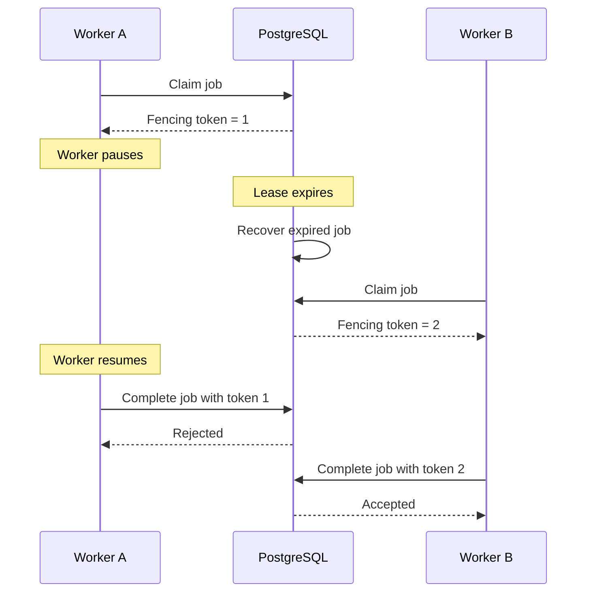

Ownership-sensitive operations validate:

```text
job_id
    +
worker_id
    +
attempt
    +
valid lease
    +
RUNNING status
```

These conditions are checked as part of the database update,
rather than through a separate read followed by an
unconditional write.

The following operations reject stale execution attempts:

- Job completion.
- Job failure.
- Lease renewal.

Fencing protects the engine's job state. It does not
automatically prevent a stale worker from performing
external side effects.

Implementation:

- [complete_job.py](engine/workers/complete_job.py)
- [fail_job.py](engine/workers/fail_job.py)
- [renew_lease.py](engine/workers/renew_lease.py)

Tests:

- [test_fencing_tokens.py](tests/integration/test_fencing_tokens.py)

## Execution Semantics

### At-Least-Once Execution

The engine is designed around at-least-once execution semantics
with bounded retries.

A job may be executed more than once when failures occur.

Consider the following scenario:

1. Worker A claims a job.
2. Worker A successfully performs a business operation.
3. Worker A crashes before marking the job as completed.
4. Its lease expires.
5. The job is recovered.
6. Worker B claims and executes the same job.

The engine cannot determine from its job state alone whether
Worker A completed the external business operation.

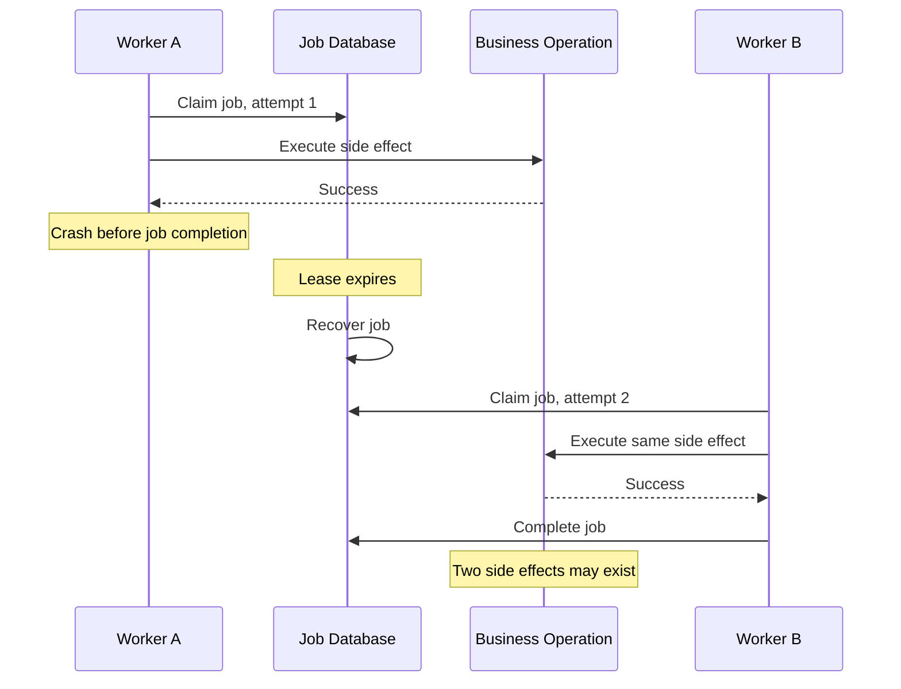

The engine does not guarantee exactly-once execution.

Bounded retries also mean that successful execution is not
guaranteed if all permitted attempts fail.

## Idempotency

Idempotency is necessary to safely handle repeated execution
of the same logical operation.

The project distinguishes between two forms of idempotency.

### Job Submission Idempotency

The jobs table contains a unique `idempotency_key`.

This prevents multiple job records from being created with
the same logical submission key.

It does not prevent an existing job from being executed
multiple times.

### Side-Effect Idempotency

A job handler must independently protect its business
operations from duplicate execution.

For database-backed operations, this can be achieved using
a stable idempotency key and a unique constraint.

The following pattern is validated through fault-injection
tests:

```sql
INSERT INTO job_effects (
    idempotency_key,
    job_id,
    worker_id,
    attempt
)
VALUES (...)
ON CONFLICT (idempotency_key)
DO NOTHING
RETURNING id;
```

The idempotency key must remain stable across execution attempts.

| Identifier      | Attempt 1 | Attempt 2 |
| --------------- | --------- | --------- |
| Job ID          | Same      | Same      |
| Idempotency key | Same      | Same      |
| Fencing token   | 1         | 2         |

Fencing tokens identify individual execution attempts.

Idempotency keys identify logical operations across attempts.

Using the attempt number as part of an idempotency key
would allow retries to create duplicate effects.

### Lease Expiration and Idempotent Effects

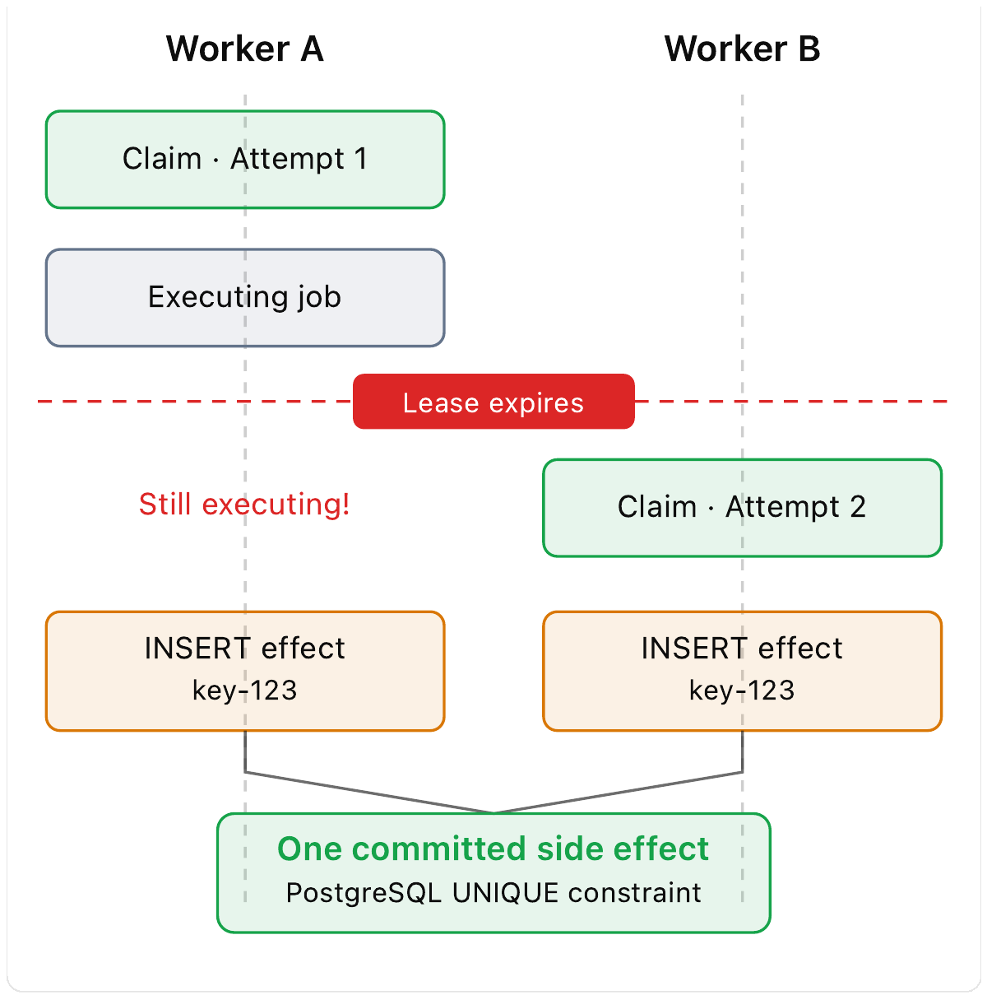

The engine may allow multiple execution attempts, but an
appropriately designed idempotent handler can ensure that
at most one effect is committed for a logical operation.

### Concurrent Idempotent Execution

Sequential retries are not the only source of duplicate effects.

A stale worker and a current worker may execute the same
logical operation concurrently.

PostgreSQL's unique constraint provides concurrency control
even when the conflicting insertion has not yet committed.

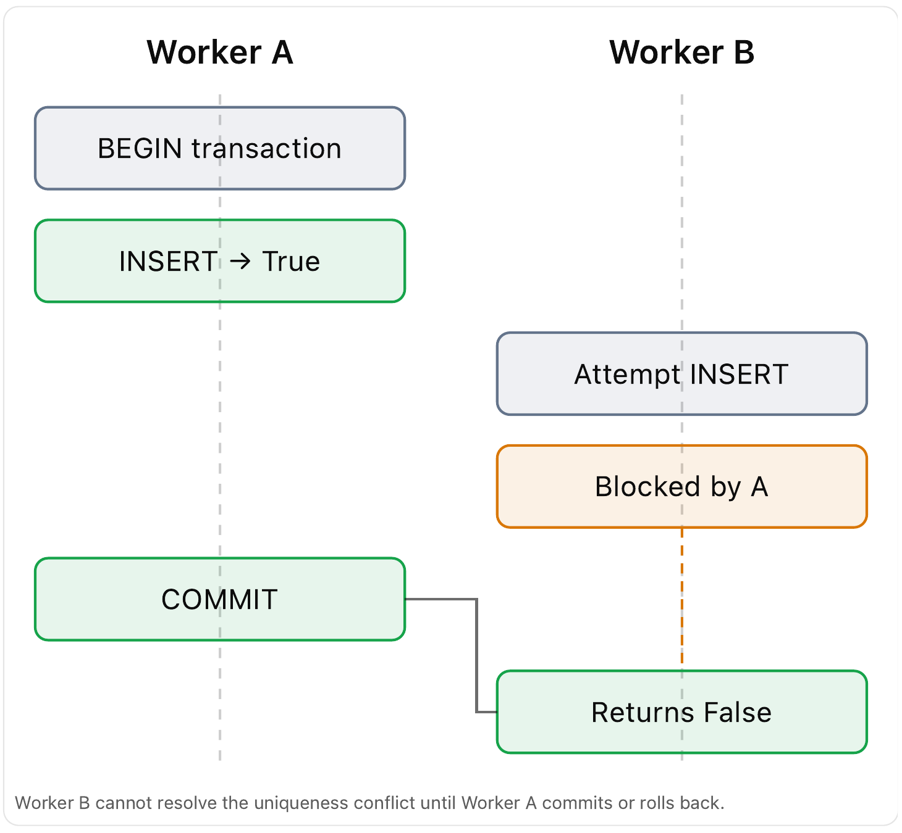

Two outcomes are possible.

#### Scenario A: First Transaction Commits

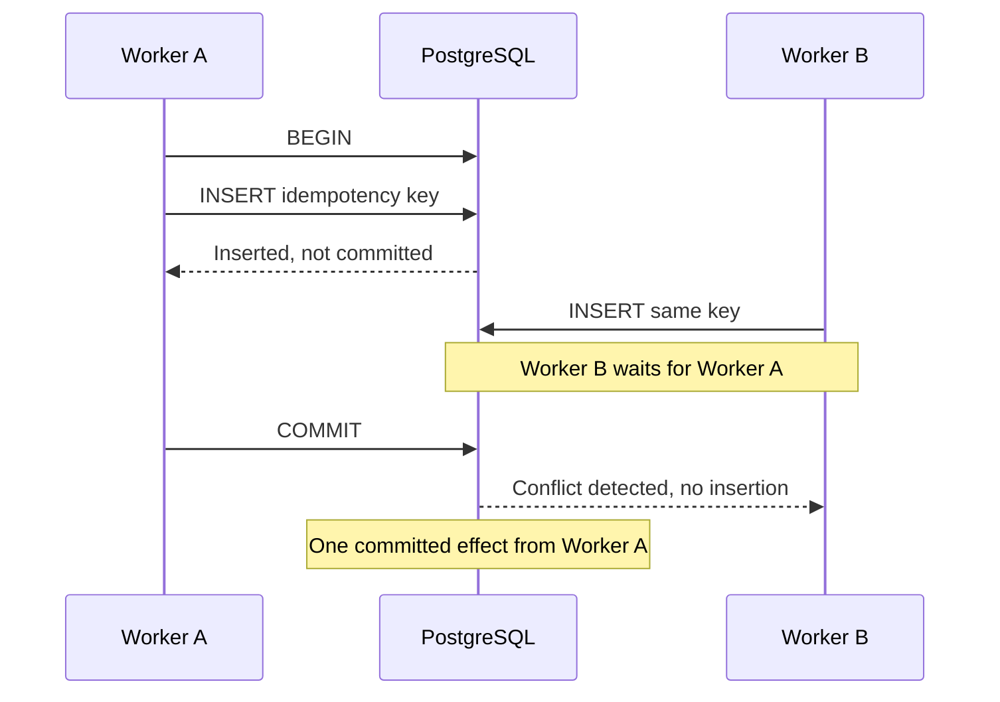

#### Scenario B: First Transaction Rolls Back

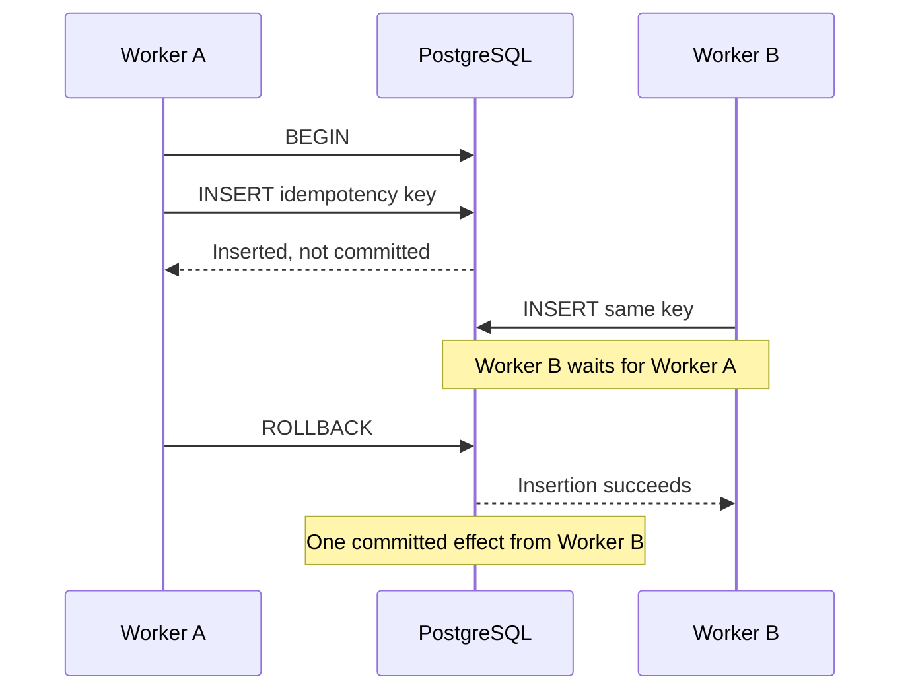

| Outcome                    | Worker A commits | Worker A rolls back |
| -------------------------- | ---------------- | ------------------- |
| Worker A insertion returns | `True`           | `True`              |
| Worker B initially blocks  | Yes              | Yes                 |
| Worker B insertion returns | `False`          | `True`              |
| Committed effects          | 1                | 1                   |
| Effect produced by         | Worker A         | Worker B            |

A successful SQL statement does not necessarily imply that
its changes have been durably committed.

### Idempotency and Transaction Atomicity

When the idempotency record and business operation reside
in the same database, they should be committed within
the same transaction.

Otherwise, a worker could record the idempotency key,
crash before performing the business operation, and
prevent future attempts from completing the operation.

For external systems, such as payment services, the
external service must provide its own appropriate
idempotency mechanism.

The `job_effects` table used in this project is a
test-only fixture for demonstrating these properties.
It is not part of the production job schema.

Documentation:

- [Idempotency](docs/06-idempotency.md)

## Correctness Guarantees

The engine implements and tests the following properties.

| Property                     | Mechanism                                  |
| ---------------------------- | ------------------------------------------ |
| Exclusive job claiming       | Row-level locking                          |
| Concurrent worker progress   | `SKIP LOCKED`                              |
| Atomic ownership transitions | PostgreSQL transactions                    |
| Time-limited ownership       | Leases                                     |
| Lease maintenance            | Heartbeats                                 |
| Stale worker rejection       | Fencing tokens and lease validation        |
| Bounded retries              | Attempt counter and maximum attempts       |
| Expired job recovery         | Conditional state transitions              |
| Idempotent recovery          | Conditional database updates               |
| Job record uniqueness        | Unique idempotency key                     |
| Idempotent handler effects   | Unique constraints and atomic transactions |

These mechanisms address different correctness concerns.

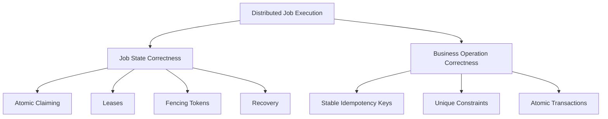

Fencing protects job state.

Idempotency protects business operations.

The engine's job state guarantees do not automatically
extend to arbitrary external side effects.

## Testing Strategy

Correctness is validated at three levels:

1. Unit testing.
2. PostgreSQL integration testing.
3. Fault-injection testing.

Integration and fault-injection tests use real PostgreSQL
connections rather than mocking database concurrency behavior.

### Test Results

Latest full test suite:

```text
==================== 23 passed in 0.84s ====================
```

| Test Category         | Passed |
| --------------------- | -----: |
| Unit tests            |      3 |
| Integration tests     |     14 |
| Fault-injection tests |      6 |
| Total                 |     23 |

The reported execution time is from a local test run
and is not a production performance benchmark.

### Unit Tests

Validate job-processing behavior independently of the
full database execution lifecycle.

| Scenario                                  | Status |
| ----------------------------------------- | ------ |
| Successful execution completes the job    | Passed |
| Failed execution triggers retry handling  | Passed |
| Lost ownership prevents job state updates | Passed |

See [Unit Tests](tests/unit/).

### Integration Tests

Validate database behavior, concurrency control,
state transitions, and ownership enforcement.

#### Job Claiming

- Only one worker claims a single available job.
- Concurrent workers claim different available jobs.
- The oldest eligible pending job is selected.

#### Failure Handling

- Failed jobs are requeued when attempts remain.
- Jobs become permanently failed when attempts are exhausted.

#### Fencing Tokens

- Stale attempts cannot complete reclaimed jobs.
- Stale attempts cannot fail reclaimed jobs.
- Stale attempts cannot renew leases.

#### Expired Job Recovery

- Expired jobs with attempts remaining become pending.
- Expired jobs without attempts remaining become failed.
- Jobs with valid leases remain unchanged.
- Completed jobs are ignored.
- Repeated recovery is idempotent.
- Concurrent recovery transitions an expired job only once.

See [Integration Tests](tests/integration/).

### Fault-Injection Tests

Fault-injection tests deliberately reproduce failure conditions
that can occur during distributed execution.

| Failure Scenario                          | Expected Behavior                    |
| ----------------------------------------- | ------------------------------------ |
| Crash before claim commit                 | Claim is rolled back                 |
| Crash after claim commit                  | Job recovered after lease expiration |
| Crash after side effect                   | Duplicate execution is possible      |
| Retry with idempotent handler             | Duplicate effect is prevented        |
| Concurrent idempotent insertion           | Only one effect is committed         |
| Concurrent insertion followed by rollback | Waiting worker successfully inserts  |

All six scenarios have passed.

The concurrent idempotency tests verify actual PostgreSQL
lock contention using:

```sql
SELECT wait_event_type, pg_blocking_pids(pid)
FROM pg_stat_activity
WHERE pid = ...;
```

This confirms that the competing worker is waiting for
a database lock held by the expected transaction.

The tests use bounded polling, thread synchronization,
and explicit exception propagation rather than relying
solely on arbitrary sleep durations.

See:

- [Worker Crash Tests](tests/fault_injection/test_worker_crash.py)
- [Duplicate Execution Tests](tests/fault_injection/test_duplicate_execution.py)
- [Fault-Injection Documentation](docs/07-fault-injection.md)

## Technology Stack

| Technology       | Purpose                                  |
| ---------------- | ---------------------------------------- |
| Python           | Core engine implementation               |
| PostgreSQL       | Persistence and distributed coordination |
| Psycopg          | PostgreSQL database access               |
| Pytest           | Automated testing                        |
| Python threading | Heartbeats and concurrent test execution |
| Mermaid          | Architecture and sequence diagrams       |

## Project Structure

```text
engine/
  persistence/      PostgreSQL connection and schema (schema.sql)
  workers/          job claiming, execution, heartbeats, completion/failure, recovery
tests/
  unit/             orchestration logic in process_job, with dependencies mocked
  integration/      claiming, fencing, and recovery against real PostgreSQL
  fault_injection/  worker crash, rollback, and duplicate-execution scenarios
docs/               design documentation; start with 00-project-overview.md
```

## Getting Started

### Prerequisites

- Python
- PostgreSQL
- A dedicated PostgreSQL test database
- Project dependencies defined in `pyproject.toml`

### Database Setup

Initialize the PostgreSQL database using:

[engine/persistence/schema.sql](engine/persistence/schema.sql)

Configure the database connection according to:

[engine/persistence/db.py](engine/persistence/db.py)

### Running Tests

Configure the dedicated test database connection:

```bash
export TEST_DATABASE_URL="postgresql:///distributed_engine_test"
```

This connects to a local PostgreSQL server as your OS user, which is the default for installs such as Homebrew.

Run the complete test suite:

```bash
pytest -v
```

Run unit tests:

```bash
pytest tests/unit/ -v
```

Run integration tests:

```bash
pytest tests/integration/ -v
```

Run fault-injection tests:

```bash
pytest tests/fault_injection/ -v
```

> Warning: Integration and fault-injection tests perform
> destructive database operations, including truncating
> job records and creating or dropping test tables.
> Never point TEST_DATABASE_URL at a production database.

The current database fixtures are designed for isolated,
serial test execution. Parallel test execution requires
additional database isolation.

## Design Decisions

### Why PostgreSQL Instead of a Dedicated Message Broker?

PostgreSQL provides the primitives required to implement
the current execution and coordination mechanisms:

- Durable persistence.
- ACID transactions.
- Row-level locking.
- Non-blocking row selection using `SKIP LOCKED`.
- Unique constraints.
- Atomic conditional updates.
- Database-level concurrency inspection.

Using PostgreSQL allows the project to explore distributed
coordination directly without introducing additional
infrastructure prematurely.

This reduces operational complexity but introduces a
dependency on PostgreSQL availability and capacity.

### Why Leases Instead of Long-Lived Database Locks?

Job execution may take considerably longer than the
transaction required to claim it.

Leases allow ownership to persist beyond the claiming
transaction without holding database row locks throughout
execution.

They also provide a mechanism for recovering jobs from
workers that stop responding.

### Why Fencing Tokens Instead of Worker IDs Alone?

Worker identifiers may be reused, and stale workers
may resume after losing ownership.

A monotonically increasing attempt counter distinguishes
different ownership generations of the same job.

### Why At-Least-Once Instead of Exactly-Once Execution?

A worker can successfully perform a business operation
and crash before recording completion.

The engine cannot atomically coordinate arbitrary external
operations with its own job state.

Rather than claiming exactly-once execution, the design
explicitly acknowledges duplicate execution and validates
idempotent handler behavior.

### Why Test Against Real PostgreSQL?

Mocked database operations cannot reproduce actual
PostgreSQL transaction behavior, row-level locking,
unique constraint contention, or transaction visibility.

Real database tests provide evidence that the coordination
mechanisms behave as intended under the tested conditions.

See [Design Decisions](docs/08-design-decisions.md).

## Known Limitations

The project is currently focused on execution correctness
rather than production readiness or maximum throughput.

Current limitations include:

- Exactly-once execution is not guaranteed.
- Successful execution is not guaranteed after retry exhaustion.
- Arbitrary external side effects are not automatically idempotent.
- Stale workers may continue executing after losing ownership.
- Strict global FIFO execution is not guaranteed.
- PostgreSQL is the central coordination dependency.
- No continuous worker runtime exists yet; `process_job` handles
  a single claimed job, but nothing repeatedly claims and processes jobs.
- Retry backoff and jitter have not yet been implemented.
- Production throughput and scalability have not yet been measured.
- Fault-injection tests simulate failures through transaction
  rollback, connection closure, and forced lease expiration.
- Actual process termination, network partitions, database
  outages, and database failover have not yet been tested.

Passing the current test suite provides evidence for the
tested correctness properties, not a formal proof of
correctness under every possible failure condition.

## Roadmap

### Phase 1: Persistence and Job Lifecycle

- [x] PostgreSQL schema
- [x] Database connection management
- [x] Job state machine
- [x] Job submission uniqueness constraint

### Phase 2: Distributed Coordination

- [x] Atomic job claiming
- [x] Concurrent worker coordination
- [x] Row-level locking
- [x] Lease-based ownership
- [x] Heartbeat mechanism

### Phase 3: Fault Tolerance

- [x] Bounded retries
- [x] Expired job recovery
- [x] Fencing tokens
- [x] Stale worker rejection

### Phase 4: Correctness and Fault Injection

- [x] Unit testing
- [x] PostgreSQL integration testing
- [x] Concurrent recovery testing
- [x] Worker crash simulation
- [x] Duplicate execution testing
- [x] Idempotent handler testing
- [x] Concurrent transaction testing
- [x] Transaction rollback testing

### Phase 5: Worker Runtime and Orchestration

- [ ] Continuous worker polling
- [ ] Independent worker processes
- [ ] Worker lifecycle management
- [ ] Idle polling backoff
- [ ] Graceful shutdown
- [ ] Periodic expired job recovery
- [ ] Database connection lifecycle management
- [ ] End-to-end multi-worker execution tests

### Phase 6: Job Submission API

- [ ] Job submission endpoint
- [ ] Idempotent submission handling
- [ ] Job status endpoint
- [ ] Request validation
- [ ] Job handler registration

### Phase 7: Observability

- [ ] Structured logging
- [ ] Job execution metrics
- [ ] Queue depth monitoring
- [ ] Worker health monitoring
- [ ] Retry and failure metrics
- [ ] Execution latency metrics

### Phase 8: Performance and Scalability

- [ ] Multi-worker throughput benchmarks
- [ ] Queue latency measurements
- [ ] Database contention analysis
- [ ] Index optimization
- [ ] Retry backoff and jitter
- [ ] Load testing
- [ ] Process-level fault injection

### Phase 9: Deployment

- [ ] Docker configuration
- [ ] Multi-worker deployment
- [ ] Continuous integration
- [ ] Reproducible local development environment

## Documentation

The `docs/` directory contains detailed explanations of the
architecture, implementation decisions, failure scenarios,
and distributed systems concepts explored throughout
the development of this project.

| Document                                                      | Description                                        |
| ------------------------------------------------------------- | -------------------------------------------------- |
| [Project Overview](docs/00-project-overview.md)               | Project goals and scope                            |
| [Architecture](docs/01-architecture.md)                       | System components and interactions                 |
| [Job Lifecycle](docs/02-job-lifecycle.md)                     | Job states and transitions                         |
| [Concurrency and Locking](docs/03-concurrency-and-locking.md) | Atomic claiming and PostgreSQL locking             |
| [Leases and Heartbeats](docs/04-leases-and-heartbeats.md)     | Time-limited worker ownership                      |
| [Retries and Recovery](docs/05-retries-and-recovery.md)       | Failure handling and job reassignment              |
| [Idempotency](docs/06-idempotency.md)                         | Duplicate execution and side-effect protection     |
| [Fault Injection](docs/07-fault-injection.md)                 | Failure scenarios and correctness validation       |
| [Design Decisions](docs/08-design-decisions.md)               | Architectural trade-offs and engineering reasoning |

## Distributed Systems Concepts

This project provides a practical implementation of:

- Distributed coordination
- Concurrency control
- Transaction isolation
- Atomic state transitions
- Row-level locking
- Lease-based ownership
- Failure detection through lease expiration
- Heartbeat mechanisms
- Fencing tokens
- Stale worker detection
- At-least-once execution
- Idempotency
- Bounded retries
- Crash recovery
- Safety and liveness
- Transaction atomicity and durability
- Fault injection
- Concurrent transaction synchronization

The primary goal is not simply to execute jobs, but to
understand and validate the correctness of job execution
when multiple workers operate concurrently and failures
are expected.
