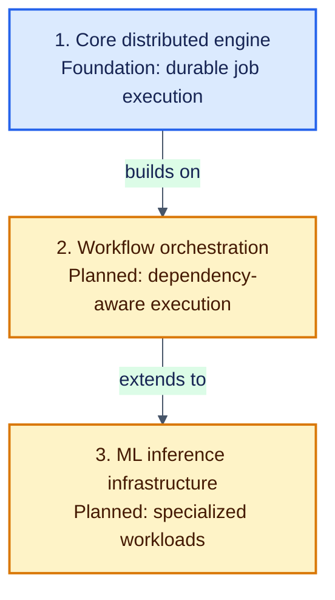

# Distributed Job Engine

## 1. Project Motivation

Modern backend systems frequently execute workloads that cannot or should not be processed within the lifecycle of a synchronous request. These include background tasks, data processing pipelines, scheduled operations, and machine learning inference.

Building a reliable execution engine for these workloads introduces several engineering challenges:

- How do multiple workers safely compete for available jobs?
- What happens when a worker crashes during execution?
- How can abandoned jobs be recovered without losing work?
- How do we prevent stale workers from modifying jobs they no longer own?
- How can we prevent duplicate side effects when jobs are retried?

This project explores these challenges by building a distributed job execution engine from first principles using Python and PostgreSQL.

Rather than relying on existing task queue frameworks, the project implements and tests the underlying mechanisms for durable job storage, concurrent job claiming, worker leases, retries, crash recovery, and idempotency.

The broader objective is to understand the correctness guarantees, failure modes, and architectural trade-offs involved in building reliable distributed infrastructure, with future support for data processing and machine learning workloads.

## 2. Project Objectives

The primary objective is to design and implement a general-purpose distributed job execution engine capable of processing asynchronous workloads reliably across multiple workers.

The project is organized into three architectural layers:

### 2.1 Core Distributed Engine

The core engine provides the foundation for reliable job execution. Its objectives are to:

- Persist submitted jobs and their execution states.
- Enable multiple workers to claim jobs concurrently.
- Coordinate worker ownership through atomic database operations.
- Detect abandoned jobs through leases and heartbeats.
- Recover jobs following worker failures.
- Support automatic retries with configurable attempt limits.
- Prevent stale workers from modifying job execution state.
- Support at-least-once execution with mechanisms for idempotent processing.
- Validate correctness through unit, integration, and fault-injection tests.

### 2.2 Workflow Orchestration

Once the core execution engine is reliable, the project will introduce dependency-aware job execution.

Planned capabilities include:

- Directed acyclic graph (DAG) scheduling.
- Job dependency tracking.
- Workflow state management.
- Failure propagation.
- Priority scheduling and concurrency controls.

### 2.3 ML Inference Infrastructure

The engine will eventually support machine learning inference as a specialized workload.

Planned capabilities include:

- Model loading and caching across workers.
- CPU and GPU worker routing.
- Dynamic inference batching.
- Model versioning.
- Resource-aware scheduling.
- Monitoring queue latency and inference latency independently.

### 2.4 Engineering Philosophy

The project prioritizes correctness before optimization and architectural complexity.

Rather than introducing multiple infrastructure components at the beginning, the initial implementation uses PostgreSQL as the durable source of truth and implements the fundamental coordination mechanisms directly.

Additional technologies will be introduced when they address demonstrated requirements or measurable limitations.

The objective is not simply to build a functioning job queue, but to understand and validate its behavior under concurrency, contention, and failure.

## Current development status

The core coordination primitives are implemented; the latest reported suite contains 23 passing tests. Continuous worker runtime is the next milestone. Workflow orchestration and ML inference remain planned. The legacy worker loop has been removed; the simulated item workload remains.
