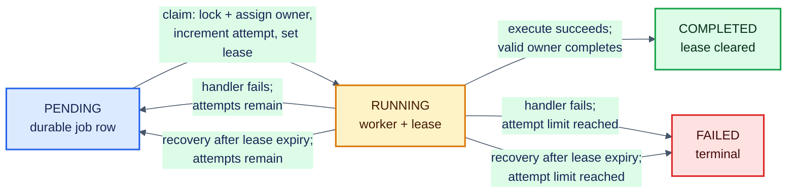
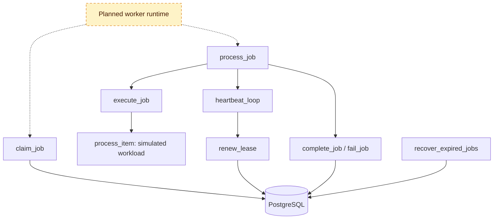

# Core Engine Architecture

> **Status:** Component-level design and behavior are implemented and tested. There is no continuous worker runtime yet; see [Current boundary and limitations](#current-boundary-and-limitations).

This section describes the current PostgreSQL-backed job lifecycle and the key decisions behind it. Workflow orchestration and ML inference are future layers, not current capabilities.

## Implemented path

PostgreSQL stores each job and its state: `PENDING`, `RUNNING`, `COMPLETED`, or `FAILED`. A running job has an owner and an expiring lease.

### How a job moves through the engine

- A worker claims the oldest eligible job in a short PostgreSQL transaction. `FOR UPDATE SKIP LOCKED` lets workers claim separate jobs concurrently.
- Each claim increments the attempt number and starts a 30-second lease. A heartbeat renews the lease every 10 seconds.
- Completion, failure, and lease renewal require the current worker, attempt, and a live lease. The attempt number fences off stale workers.
- Failed or expired jobs return to `PENDING` while attempts remain; otherwise they become `FAILED`. The default limit is three attempts.

The implementation is in [`engine/persistence/schema.sql`](../engine/persistence/schema.sql) and [`engine/workers/`](../engine/workers/).

## Design journal: decisions and lessons

### PostgreSQL as the first coordination mechanism

An early design considered a separate queue and a cache-based “in progress” check. Two workers could race between checking and recording ownership. The implementation uses PostgreSQL to claim and update a job atomically, keeping durable state and ownership together. Redis was deferred until a measurable need exists.

### A lease detects abandonment; it does not stop an old worker

A lease makes a job eligible for recovery; it does not stop the original worker. Worker ID, attempt number, and lease checks reject stale updates to the job row, but cannot undo an external side effect.

### At-least-once execution and idempotent effects

If a worker performs an effect and crashes before recording completion, the handler can run again. Tests show that an idempotency key can prevent duplicate committed effects. Execution is still at-least-once; exactly-once effects are not an engine-wide guarantee. The schema reserves unique job idempotency keys, but a client submission API is not implemented.

## Evidence and guarantees

The claim, recovery, and fencing behavior is covered by [integration tests](../tests/integration/). Ownership handling and duplicate effects are covered by [unit and fault-injection tests](../tests/unit/test_process_job.py) and [`test_duplicate_execution.py`](../tests/fault_injection/test_duplicate_execution.py). These tests cover selected operations and failure scenarios, not every production failure mode.

## Current boundary and limitations

- **No continuous worker runtime exists.** `process_job` handles a single claimed job with heartbeats, but there is no loop that repeatedly claims and processes jobs. The legacy `run_worker` loop was removed because it bypassed `process_job` and the heartbeat path; the runtime will be rebuilt in a later milestone.
- **No submission API or production handler exists.** The current item processor is illustrative; idempotent effects are demonstrated in tests.
- **Fault injection is controlled.** Tests use connection closure, rollback, and forced lease expiration. They do not cover actual process termination, database outages, or network partitions.
- **Workflow, ML inference, and performance work are future work.** DAG scheduling, inference features, and throughput or latency benchmarks are not implemented.

## Component architecture

The following is a logical component diagram, not a claim that a continuous runtime already exists.

Claiming is a short transaction; processing is a separate responsibility and must begin after the claim commits. The heartbeat uses a separate connection so renewal can proceed independently of execution and its transaction state. `process_job` coordinates one attempt, not polling. The old `run_worker.py` bypassed this coordinator and used an outdated execution signature. `process_item.py` remains a simulated workload called by `execute_job`.
