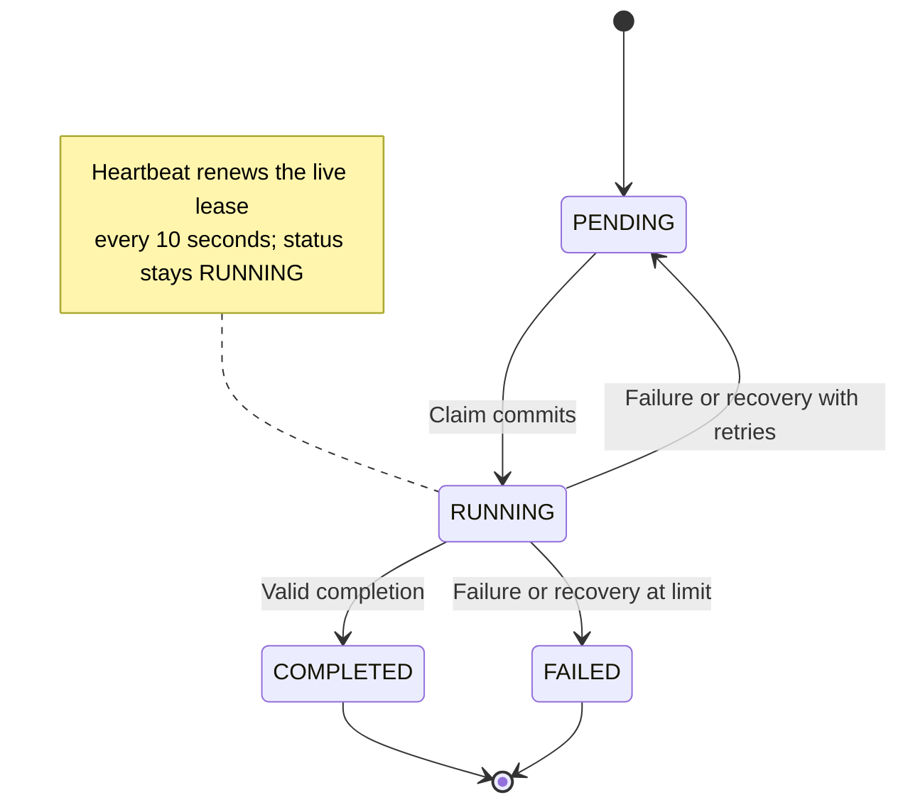

# Job Lifecycle

The engine stores each job in PostgreSQL. The current state model has four states:

| State | Meaning |
|---|---|
| `PENDING` | Available for a worker to claim. |
| `RUNNING` | Claimed by a worker; the lease may have expired while awaiting recovery. |
| `COMPLETED` | Execution completed while the worker still owned the lease. |
| `FAILED` | The configured attempt limit was reached. |

## Transitions

- **Claim:** `PENDING` → `RUNNING`. The claim records the worker, starts a lease, and increments the attempt.
- **Successful execution:** `RUNNING` → `COMPLETED`, if the worker still owns a live lease.
- **Handler failure:** `RUNNING` → `PENDING` if another attempt is allowed; otherwise `FAILED`.
- **Expired lease:** recovery returns the job to `PENDING` if attempts remain; otherwise it sets `FAILED`.

Recovery clears the owner and lease, but does not consume an attempt. The next successful claim increments the attempt. The default limit is three attempts.

The transitions are implemented in [`claim_job.py`](../engine/workers/claim_job.py), [`complete_job.py`](../engine/workers/complete_job.py), [`fail_job.py`](../engine/workers/fail_job.py), and [`recover_expired_job.py`](../engine/workers/recover_expired_job.py). The schema enforces valid states and requires an owner and lease for every `RUNNING` job: [`schema.sql`](../engine/persistence/schema.sql).

## Boundary

The repository has no job-submission API. Tests insert job rows directly, so this lifecycle begins with a persisted `PENDING` row and does not describe client request handling or submission acknowledgments.

See [Architecture](01-architecture.md) for the overall system and [Retries and Recovery](05-retries-and-recovery.md) for attempt-limit behavior.

## State machine

Lease expiry alone does not change the stored status; recovery must execute.

## Ownership transitions

| Operation | Result | Worker ID | Lease | Attempt |
|---|---|---|---|---|
| Insert | PENDING | NULL | NULL | 0 |
| Claim | RUNNING | Assigned | Set | +1 |
| Renew | RUNNING | Preserved | Extended | Preserved |
| Complete | COMPLETED | Retained | Cleared | Preserved |
| Fail or recover, retries remain | PENDING | Cleared | Cleared | Preserved |
| Fail or recover, limit reached | FAILED | Cleared | Cleared | Preserved |

The schema requires a worker and non-null lease for RUNNING rows. A non-null lease is not necessarily live. Transition functions enforce valid ownership using RUNNING status, matching worker ID and attempt, and an unexpired lease. These are operation-level conditions, not all schema constraints.
