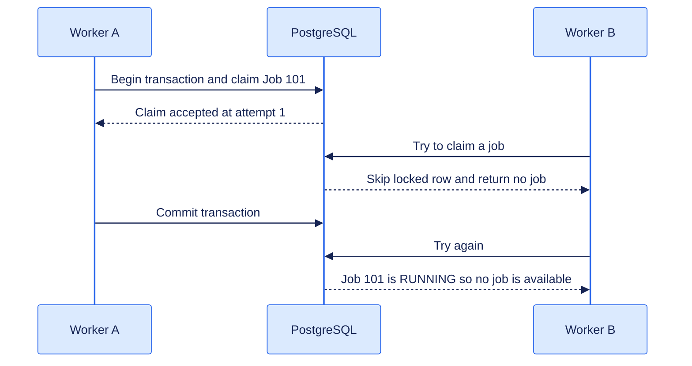
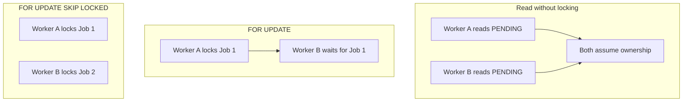

# Concurrency and Locking

Workers coordinate through PostgreSQL. A claim selects one eligible `PENDING` row and updates its owner and lease in the same transaction.

```sql
SELECT id
FROM jobs
WHERE status = 'PENDING' AND attempt < max_attempts
ORDER BY created_at, id
FOR UPDATE SKIP LOCKED
LIMIT 1
```

The selected row is then changed to `RUNNING`, assigned to the worker, and returned by the same statement in [`claim_job.py`](../engine/workers/claim_job.py).



In this single-job integration test, Worker A holds an outer transaction open so the row lock remains active while Worker B tries to claim. `FOR UPDATE SKIP LOCKED` prevents the workers from taking the same locked row. When the claim owns the outermost transaction, it commits when `claim_job` returns; leases then represent ownership during execution.

Jobs are ordered by `created_at, id`, so the oldest unlocked eligible job is preferred. Under contention, a locked older job can be skipped and a newer one claimed. This is not strict global FIFO.

The integration tests verify exclusive claims, parallel claims of different jobs, and oldest-first selection without contention: [`test_claim_job.py`](../tests/integration/test_claim_job.py). Partial indexes support pending-job claims and expired-lease recovery in [`schema.sql`](../engine/persistence/schema.sql).

The original design considered a separate cache-based ownership check. Two workers could both pass a check before either recorded ownership. PostgreSQL's atomic claim avoids that race without adding Redis as a second coordination system.

## Why locking is necessary

An unguarded read followed by an unconditional ownership update can race. A plain FOR UPDATE protects the selected row but may make another worker wait even when other jobs exist. SKIP LOCKED lets workers select different unlocked rows.



## Transaction boundaries

A transaction context nested inside an existing Psycopg transaction creates a savepoint. Releasing it does not commit the outer transaction. The outer transaction must commit before execution begins. Under PostgreSQL READ COMMITTED, competing updates can wait and recheck their predicates after a conflicting update commits.

## Partial indexes

The pending index on `(created_at, id)` restricted to PENDING rows supports ordered claims. The running index on `lease_expires_at` restricted to RUNNING rows supports recovery. These indexes align with access patterns; their performance has not yet been benchmarked.
