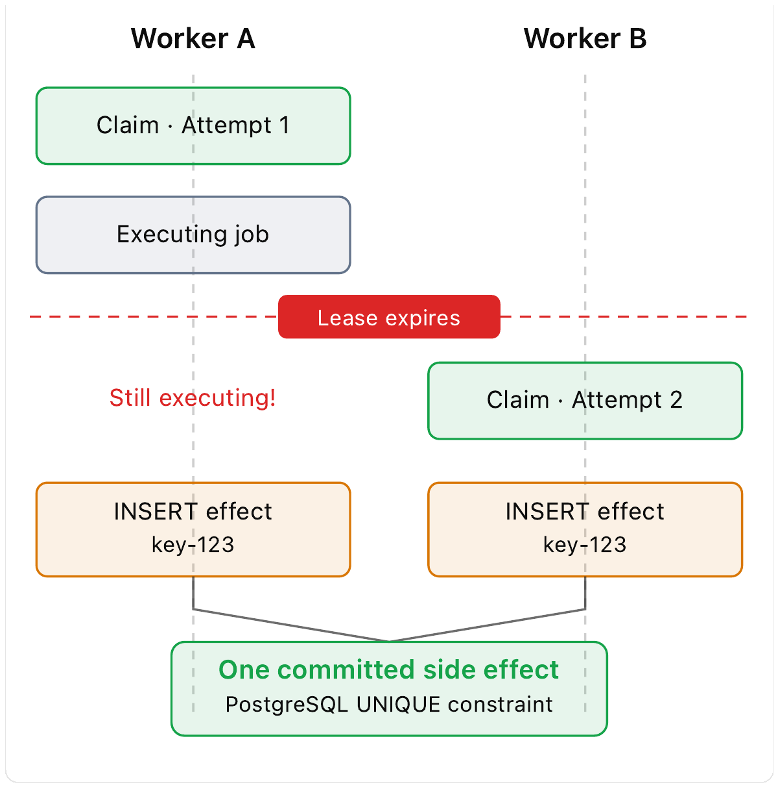
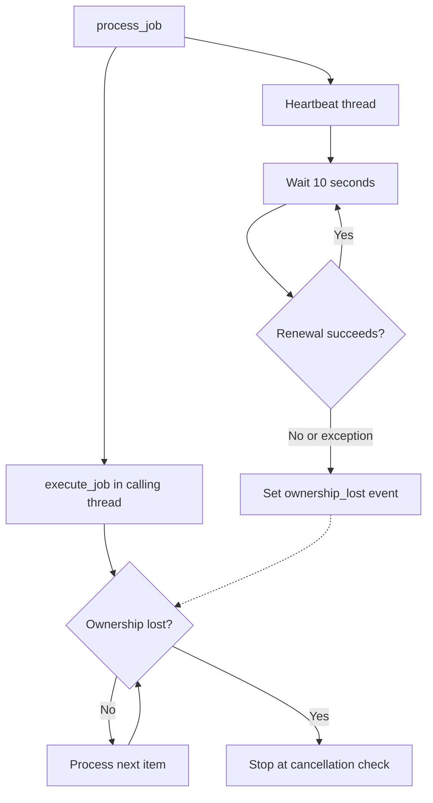

# Leases and Heartbeats

A lease makes a running job recoverable if its worker stops renewing ownership. It does not prove the worker has stopped.

## How ownership is renewed

- A claim creates a 30-second lease by default.
- `heartbeat_loop` attempts renewal every 10 seconds.
- PostgreSQL time is used for lease comparisons.
- Renewal requires the row to remain `RUNNING`, the worker and attempt to match, and the existing lease to be unexpired.

If renewal fails or its result is uncertain, the heartbeat signals ownership loss. `process_job` then avoids completing or failing the row. See [`heartbeat_loop.py`](../engine/workers/heartbeat_loop.py), [`renew_lease.py`](../engine/workers/renew_lease.py), and [`process_job.py`](../engine/workers/process_job.py).

## Expiry and stale workers

When a lease expires, recovery can make the job available to another worker. The original worker may still be running, so state updates are fenced by worker ID and attempt number:

*The test uses a PostgreSQL effect table. Fencing protects job state; the effect needs its own idempotency key.*

The lease and fencing checks protect the job row. They cannot stop an old process from continuing work or undo an external side effect it already performed. Handler idempotency is covered in [Idempotency](06-idempotency.md).

Tests verify that valid leases are not recovered and that stale attempts cannot renew, complete, or fail a reclaimed job: [`test_recover_expired_jobs.py`](../tests/integration/test_recover_expired_jobs.py) and [`test_fencing_tokens.py`](../tests/integration/test_fencing_tokens.py).

**Runtime limitation:** the heartbeat path exists in `process_job`, but no continuous worker loop drives it yet. The `process_job` unit tests mock both `execute_job` and `heartbeat_loop`, so real heartbeat behavior during a long-running workload is not yet verified; see [Architecture](01-architecture.md).

## Heartbeat coordination and cooperative cancellation

The event is checked between items. It cannot forcibly interrupt an item already running. Heartbeat success indicates lease maintenance, not business progress. The database remains the final authority for completion and failure.

## Illustrative lease timeline

```mermaid
gantt
    title Successful renewals (illustrative seconds)
    dateFormat X
    axisFormat %S
    section Lease windows
    Initial lease : 0, 30s
    Renewal at 10s : 10, 30s
    Renewal at 20s : 20, 30s
```

At t=0 the lease expires at t=30; successful renewals at t=10 and t=20 move expiry to t=40 and t=50 respectively. Actual renewal timing can vary.
