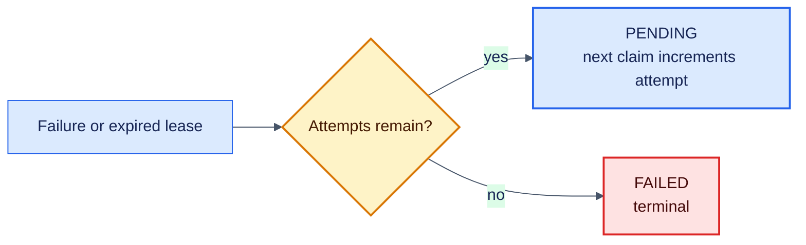
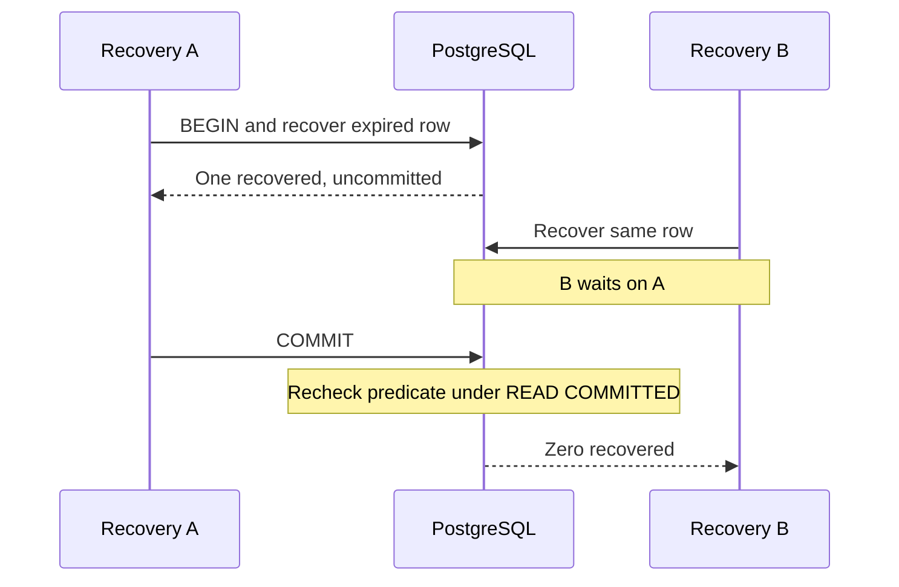

# Retries and Recovery

The engine retries failed or abandoned work up to a per-job attempt limit. `max_attempts` defaults to 3.

## Handler failure

Each claim increments `attempt`. If the handler fails while the worker still owns a live lease, `fail_job` clears the owner and lease and:

- returns the job to `PENDING` when `attempt < max_attempts`;
- sets the job to `FAILED` when the limit has been reached.

## Worker abandonment

`recover_expired_jobs` finds `RUNNING` jobs whose lease has expired. It applies the same attempt-limit rule, clears ownership, and returns counts of retried and failed jobs. Recovery itself does not increment the attempt; the next claim does.

The behavior is implemented in [`fail_job.py`](../engine/workers/fail_job.py) and [`recover_expired_job.py`](../engine/workers/recover_expired_job.py). Integration tests cover retry limits, valid leases, idempotent recovery, and concurrent recovery: [`test_fail_job.py`](../tests/integration/test_fail_job.py), [`test_recover_expired_jobs.py`](../tests/integration/test_recover_expired_jobs.py).

**Current limits:** retries are immediate; there is no exponential backoff or dead-letter queue. These mechanisms handle state recovery, but external effects still need idempotent handlers. There is also no continuous worker runtime yet to run recovery periodically.

## Retry exhaustion example

## Concurrent recovery

The second update rechecks eligibility after the first commits. The row is no longer RUNNING, so it is not recovered again. No separate distributed recovery lock is required for this tested transition.
