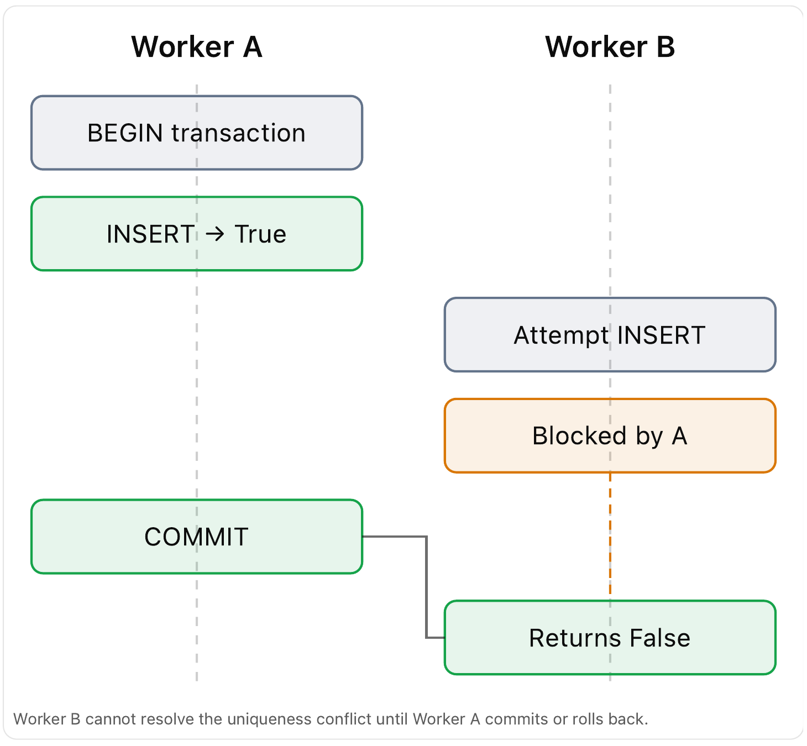
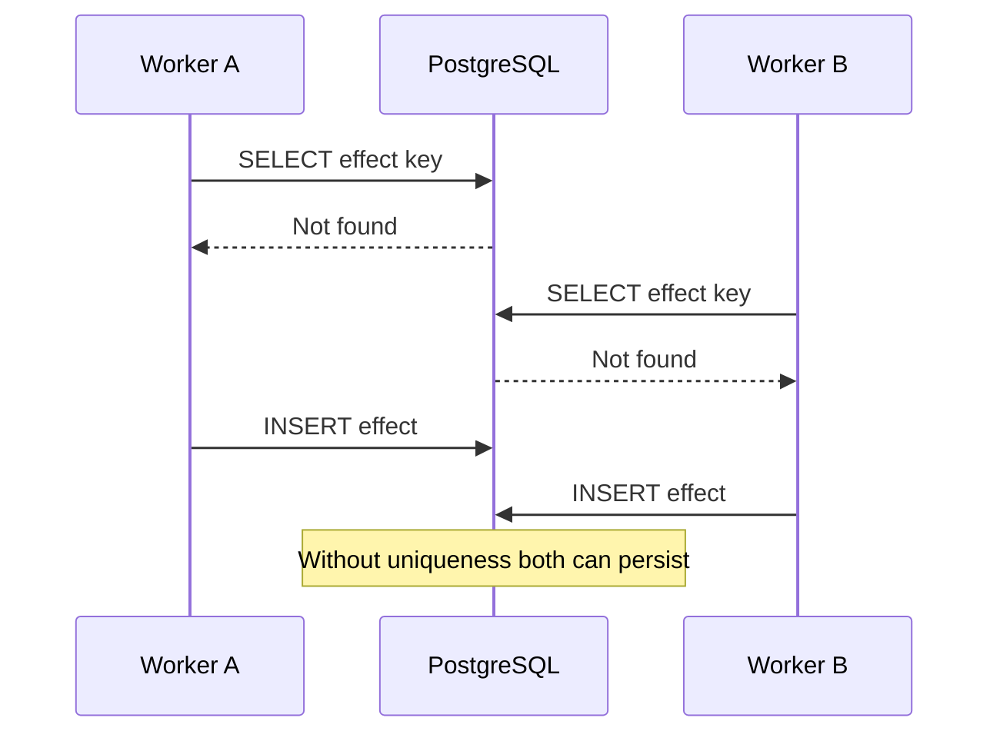
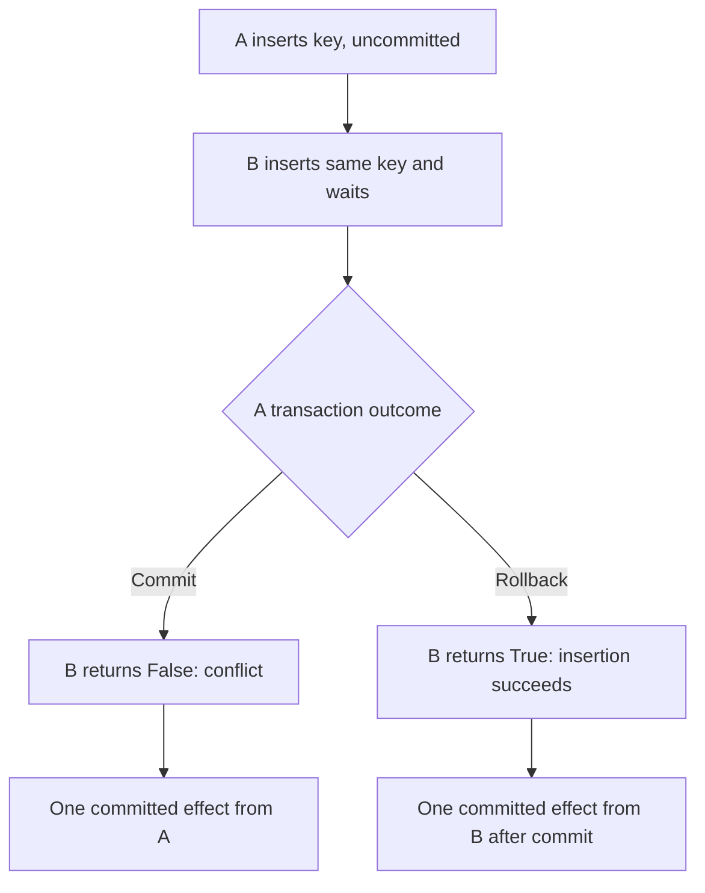

# Idempotency

At-least-once execution means a handler may run again if a worker performs work and crashes before recording completion. Idempotency is the application-level way to prevent a retry from duplicating an effect.



*The unique-key conflict exercised by the concurrent idempotency test.*

## Two different keys

- **Job submission key:** `jobs.idempotency_key` is unique, so the database rejects two job rows with the same key. There is no submission API that returns the original job when a client retries.
- **Effect key:** a handler can apply a unique key to its side effect and treat a conflict as already done. The fault-injection tests demonstrate this with a `job_effects` table and `ON CONFLICT DO NOTHING`.

The tests show both sides: a non-idempotent effect is recorded twice after a simulated worker crash; a unique effect key leaves one committed effect. Concurrent idempotent inserts and rollback behavior are also covered in [`test_duplicate_execution.py`](../tests/fault_injection/test_duplicate_execution.py).

This does not make the engine exactly-once. The handler or destination system must provide the idempotency boundary, especially when effects happen outside PostgreSQL. See [Leases and Heartbeats](04-leases-and-heartbeats.md) for why stale workers may continue running.

## Stable identity and duplicate execution

A worker can commit an effect, lose its lease before completing the job, and cause another attempt to repeat the operation. The effect key must identify the logical operation, not its attempt.

| Identity | Attempt 1 | Attempt 2 |
|---|---|---|
| Job ID | Same | Same |
| Effect key | charge-customer-42 | charge-customer-42 |
| Fencing token | 1 | 2 |

## Check-then-insert race



A normal row lock cannot lock a nonexistent row. A unique constraint and atomic insertion resolve this race:

```sql
INSERT INTO job_effects (idempotency_key, job_id, worker_id, attempt)
VALUES (%s, %s, %s, %s)
ON CONFLICT (idempotency_key) DO NOTHING
RETURNING id;
```

## Concurrent commit versus rollback



| Result | A commits | A rolls back |
|---|---|---|
| A insertion returns | True | True |
| B initially blocks | Yes | Yes |
| B insertion returns | False | True |
| Durable effect after both finish | A | B |

A successful statement is not necessarily a committed transaction. If the effect and deduplication record are separate writes in the same database, they must commit atomically. For external operations, the destination must provide an appropriate idempotency mechanism. The `job_effects` table is test-only, not production schema.

Fencing protects job state; idempotency protects logical effects. Neither guarantees successful execution after retry exhaustion.
