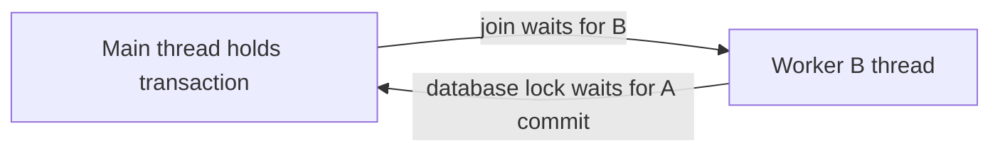

# Fault-Injection Evidence

The tests exercise failure boundaries around database transactions, leases, and repeated effects. They provide evidence for specific behaviors, not a proof of production reliability under every failure mode.

| Scenario | What the test demonstrates | Test |
|---|---|---|
| Worker fails before claim transaction commits | The uncommitted claim rolls back and the job remains claimable. | [`test_worker_crash.py`](../tests/fault_injection/test_worker_crash.py) |
| Worker fails after claim commits | The job remains `RUNNING` until its lease expires and recovery requeues or fails it. | [`test_worker_crash.py`](../tests/fault_injection/test_worker_crash.py) |
| Effect commits before worker failure | A retry can repeat a non-idempotent effect. | [`test_duplicate_execution.py`](../tests/fault_injection/test_duplicate_execution.py) |
| Same effect is retried with a unique key | Only one committed effect remains, including concurrent insert attempts. | [`test_duplicate_execution.py`](../tests/fault_injection/test_duplicate_execution.py) |
| Recovery or stale worker operations contend | Recovery changes a job once; stale attempts cannot settle reclaimed jobs. | [`test_recover_expired_jobs.py`](../tests/integration/test_recover_expired_jobs.py), [`test_fencing_tokens.py`](../tests/integration/test_fencing_tokens.py) |

The worker-crash scenarios use database connection closure, transaction rollback, and forced lease expiration. They do not kill an operating-system process or simulate database outages, network partitions, or prolonged infrastructure failures.

The full suite passes all 23 tests (3 unit, 14 integration, 6 fault-injection); see [Test Results](../README.md#test-results) in the README. These tests do not establish production-scale throughput or latency. Current test coverage is under [`tests/`](../tests/).

## Individual experiments

Each experiment below records its hypothesis, setup, observed result and lesson. All six passed in the reported suite.

### Crash before claim commit

**Hypothesis:** An uncommitted claim must disappear.

**Setup:** Raise an exception inside the outer claim transaction.

**Result:** PENDING, attempt 0; B claims attempt 1.

**Engineering lesson:** Atomicity.

**Source:** [`test_worker_crash_before_claim_commit`](../tests/fault_injection/test_worker_crash.py).

### Crash after claim commit

**Hypothesis:** Committed ownership survives disconnect.

**Setup:** Close A connection, expire lease, run recovery.

**Result:** B cannot claim before recovery; afterward claims attempt 2.

**Engineering lesson:** Durability and lease recovery.

**Source:** [`test_worker_crash_after_claim_commit`](../tests/fault_injection/test_worker_crash.py).

### Duplicate execution

**Hypothesis:** Retry can repeat a committed effect.

**Setup:** A commits effect before simulated crash; B retries.

**Result:** Two effect rows; job completes.

**Engineering lesson:** At-least-once execution is not exactly-once.

**Source:** [`test_job_can_execute_twice_after_worker_crash`](../tests/fault_injection/test_duplicate_execution.py).

### Idempotent retry

**Hypothesis:** Stable key prevents duplicate effect.

**Setup:** Repeat prior scenario with unique effect key.

**Result:** One committed effect; retry completes.

**Engineering lesson:** Logical operation identity.

**Source:** [`test_idempotent_handler_prevents_duplicate_side_effects`](../tests/fault_injection/test_duplicate_execution.py).

### Concurrent commit

**Hypothesis:** Conflicting insert waits then skips.

**Setup:** A holds uncommitted effect; B inserts same key; A commits.

**Result:** B returns False; one effect from A; stale completion rejected.

**Engineering lesson:** Unique constraint synchronization.

**Source:** [`test_concurrent_idempotent_handlers_record_single_effect`](../tests/fault_injection/test_duplicate_execution.py).

### Concurrent rollback

**Hypothesis:** Waiting insert can proceed after rollback.

**Setup:** A holds uncommitted effect; B waits; A rolls back.

**Result:** B returns True; one effect from B; stale completion rejected.

**Engineering lesson:** Statement success differs from durability.

**Source:** [`test_concurrent_idempotent_handler_succeeds_after_rollback`](../tests/fault_injection/test_duplicate_execution.py).

## Verifying real contention

```sql
SELECT wait_event_type, pg_blocking_pids(pid)
FROM pg_stat_activity WHERE pid = %s;
```

A separate monitoring connection verifies the expected blocker, rather than inferring blocking from a live thread. Bounded polling uses a monotonic deadline; background exceptions are propagated and final database state is checked. Join the competing thread outside the transaction holding the lock.



This circular wait spans Python and PostgreSQL; the database cannot see the Python join dependency. A database lock timeout provides a fallback, not a substitute for correct synchronization.
